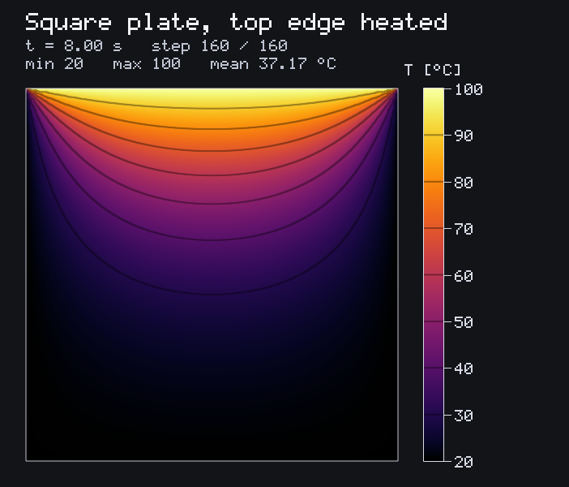
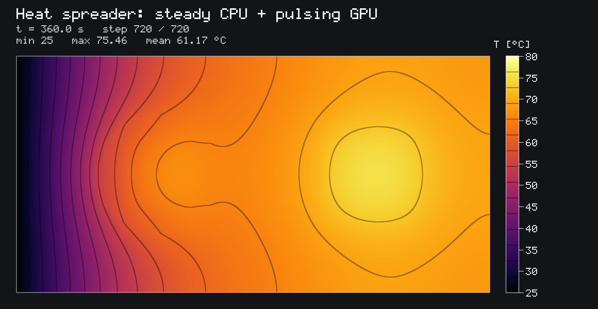
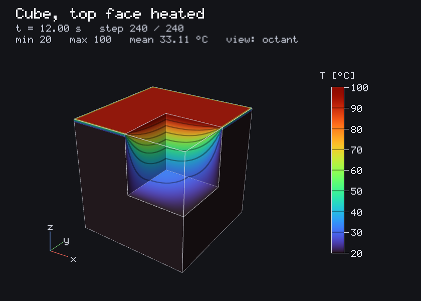
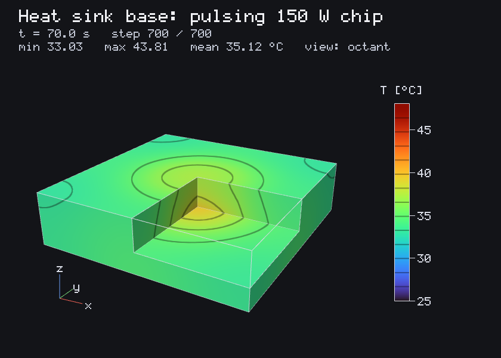
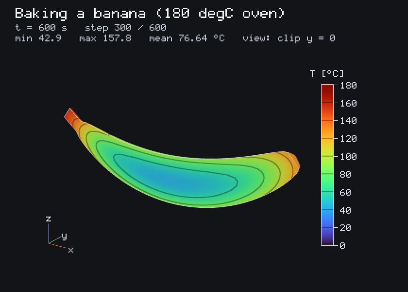
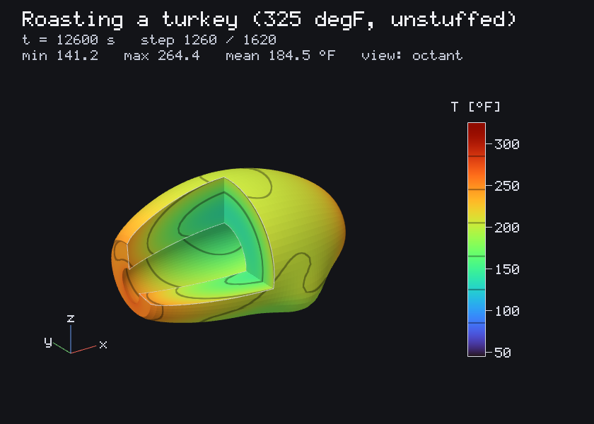

# FiniteCore

Transient heat conduction in **2D and 3D** with the **finite element method**,
time-stepped on the GPU with **Vulkan compute** and animated live with **Vulkan
graphics**. Written in C++20.

```
rho c dT/dt = div(k grad T) + Q     linear (P1) triangles in 2D, tetrahedra in 3D, theta-scheme in time
```

Everything is configured from a small INI file: geometry and mesh density,
materials (with regions), boundary conditions, heat sources, initial state,
time integration, solver, view and outputs. Any value can be an expression in
`x`, `y`, `z`, `t` and your own named constants.

| 2D: `configs/simple_plate.ini` | 2D: `configs/heat_spreader.ini` |
|---|---|
|  |  |
| **3D: `configs/cube_3d.ini`** | **3D: `configs/heat_sink_3d.ini`** |
|  |  |
| **3D: `configs/banana.ini`** (curved `tube` mesh) | **3D: `configs/turkey.ini`** (hollow `tube` mesh, °F) |
|  |  |

## Build

Requirements: CMake ≥ 3.20, a C++20 compiler, Vulkan headers + loader and a
Vulkan **1.3** driver, `glslangValidator`, zlib, and optionally GLFW ≥ 3.3 for
the live window (without GLFW you get a headless build).

```bash
# Debian/Ubuntu
sudo apt install cmake g++ libvulkan-dev glslang-tools zlib1g-dev libglfw3-dev mesa-vulkan-drivers

cmake -S . -B build -DCMAKE_BUILD_TYPE=Release
cmake --build build -j
```

The shaders are compiled to SPIR-V at build time and embedded in the binary.

## Run

```bash
./build/finitecore configs/simple_plate.ini                 # 2D, live window + files
./build/finitecore configs/cube_3d.ini                      # 3D, live window + files
./build/finitecore configs/cube_3d.ini --headless           # files only (GIF, CSV, ...)
./build/finitecore configs/heat_sink_3d.ini
./build/finitecore configs/banana.ini                       # a curved 3D shape: baking a banana
./build/finitecore configs/turkey.ini                       # a hollow 3D shape: roasting a turkey
./build/finitecore configs/verify_sine_3d.ini --headless    # compare against the exact solution
```

Useful options:

| Option | Meaning |
|---|---|
| `--set section.key=value` | override any config value, e.g. `--set mesh.cells=64,64,64` or `--set view.mode=slices` |
| `--headless` | no window; run as fast as possible and write the outputs |
| `--no-output` | do not write files |
| `--compare-cpu` | also run a double-precision CPU reference; report the GPU/CPU difference and timings |
| `--device N`, `--list-devices` | choose the Vulkan device (default: discrete > integrated > software) |
| `--exit-when-done` | close the window when the simulation ends |
| `--profile` | print GPU submission statistics |
| `--validation` | enable the Khronos validation layer (if installed) |

Window keys: `space` pause · `r` restart · `+`/`-` playback speed · `m` mesh
wireframe · `c` cycle colormap · `s` screenshot · `q`/`Esc` quit.
In 3D also: **drag** to rotate · **scroll** to zoom · `v` cycle view mode
(surface → clip → octant → slices) · `x`/`y`/`z` choose the cut axis · arrow
keys move the cut · `Home` reset the view.

### Outputs (in `output/<config name>/` by default)

* `animation.gif` – the animated time series (one frame per `output.interval`)
* `timeseries.csv` – time, min/max/mean temperature, probe values, errors vs. `[verify] exact`
* `frames/frame_NNNNN.png` – lossless frames (`png = true`)
* `field.pvd` + `vtk/*.vtu` – the full FE field over time for ParaView (`vtk = true`; open the `.pvd`)

## The simple cases

`configs/simple_plate.ini` (2D): a 10 cm × 10 cm aluminium plate at 20 °C; at
t = 0 the top edge is held at 100 °C while the other edges stay at 20 °C. The
centre probe ends at 39.9996 °C; the exact steady value is 20 + 80/4 = 40 °C
(superpose the four rotated one-hot-edge problems).

`configs/cube_3d.ini` (3D): the same experiment on a 10 cm cube, top face at
100 °C and the other five faces at 20 °C, shown with the octant facing the camera
cut away. The centre probe ends at 33.3333 °C; the exact steady value is
20 + 80/6 = 33.33 °C.

## Roasting a turkey

`configs/turkey.ini` (3D, in °F): a thawed (40 °F), unstuffed ~20 lb turkey roasted
at 325 °F for 4.5 hours, breast side up on a rack in a roasting pan. The body is a
hollow `tube`: a deep breast, a thin back and the thighs around the empty body
cavity, which is open at the neck and the tail. The skin, the skin below the pan's
rim and the cavity wall each get their own effective heat transfer coefficient
(the skin's includes evaporative cooling), chosen so that the timing matches the
USDA chart (4¼–4½ h for an unstuffed 18–20 lb bird).

| at 165 °F (done) | breast, mid-depth | coldest spot in the bird (deep breast, by the cavity) |
|---|---|---|
| reached after | 4.0 h | 4.3 h |

At 4.5 h the breast reads ~178 °F and the inner thigh ~186 °F. Bones, drumsticks,
wings and carry-over cooking during the rest are not modelled.

## Configuration reference

Values are expressions: `+ - * / % ^`, comparisons (`< <= > >= == !=` → 0/1),
`&& || !`, `pi`, `e`, and `sin cos tan asin acos atan sinh cosh tanh exp log
log10 log2 sqrt abs floor ceil round sign step min max pow mod hypot atan2
clamp(v,lo,hi) if(c,a,b)`. Variables `x`, `y`, `z` (m) and `t` (s) are allowed
where noted (`z` only in 3D). `#` starts a comment. Unknown keys are reported
(typo protection).

| Section | Keys (default) |
|---|---|
| global | `title` |
| `[constants]` | `name = expression`, evaluated in order, usable everywhere (case-sensitive) |
| `[mesh]` | `size = Lx, Ly` (2D) or `size = Lx, Ly, Lz` (3D box; z is up) — 2D also accepts `width`, `height` · `origin` (0, …) · `cells = nx, ny[, nz]` or `nx`, `ny`, `nz` (missing counts keep cells cubic; nx defaults to 64 in 2D, 32 in 3D) · `type` = rectangle / box (inferred from `size`) / tube · 2D only: `pattern` = alternating / right / left, `thickness` (1 m) |
| `[mesh]` `type = tube` | a solid swept along a circular arc in the x-z plane, centred on `origin`: `length` (m, along the centre line) · `bend` (radius of the arc in m; 0 = straight along x) · `radius = expr(s)` (m; `s` = 0…1 from the start to the end) · `section = expr(angle, s)` (relative radius around the centre line, default 1 = round; `angle` 0 points to the centre of the bend, +z for a straight tube, and π/2 to −y) · `cavity = expr(s)` (optional: m, radius of a round hole along the centre line, open at both ends) · `cells = along, across` (hollow: across/2 cells through the wall, 4 × across around). Sides: `start`, `end`, `surface`, and `cavity` when hollow. The radius must stay below `bend`. |
| `[material]` | `conductivity` k [W/(m K)], `density` ρ [kg/m³], `specific_heat` c [J/(kg K)] — required |
| `[material.NAME]` | a region + any of the three properties; later sections win. Regions: `rect = x0,y0,x1,y1` · `circle = cx,cy,r` (in 3D these extend through all z: a prism / cylinder) · `box = x0,y0,z0,x1,y1,z1` · `sphere = cx,cy,cz,r` (3D) · `where = expr(x,y[,z])` |
| `[initial]` | `temperature = expr(x,y[,z])` |
| `[boundary.NAME]` | `side` (default: NAME; a list is allowed) = 2D: left/right/bottom/top, 3D: left/right (x), front/back (y), bottom/top (z), or `all`; aliases `xmin xmax ymin ymax zmin zmax` · optional `where = expr` (facet centroid) · `type` = `dirichlet` (`temperature`) / `neumann` (`flux` W/m² into the body, may use t) / `robin` (`h` W/(m² K); `ambient`, may use t) / `insulated`. Unassigned facets are insulated; later sections win. |
| `[source.NAME]` | optional region (default: everywhere) and either `power` (W, total over the region, may use t) or `power_density` (W/m³, may use x, y, z, t) |
| `[faces]` | 2D plate model only: `h`, `ambient`, `count` (2): convection from the plate's large faces |
| `[time]` | `end` (s, required) · `dt` (s or `auto`) · `scheme` = explicit / backward_euler / crank_nicolson / theta (+ `theta`) · `mass` = auto / consistent / lumped |
| `[solver]` | `tolerance` (1e-6, relative CG residual per step) · `max_iterations` (1000) |
| `[view]` | `window` (true) · `height` (800) · `width` (auto) · `playback` (12 s for the whole run) · `range` = auto / dynamic / `min, max` · `colormap` = inferno / viridis / turbo / gray · `contours` (10) · `mesh` (false) · `unit` (°C). 3D only: `mode` = surface / clip / octant / slices (octant) · `axis` = x / y / z (clip axis) · `cut = x, y, z` (domain centre) · `yaw` (−60°), `pitch` (25°), `zoom` (1) · `spin` (0; degrees of camera turn per second of playback) |
| `[output]` | `directory` (output/NAME) · `interval` (end/120) · `gif` (true) · `csv` (true) · `png` (false) · `vtk` (false) · `height` (600) · `width` (auto) · `gif_fps` (20) |
| `[probes]` | `name = x, y[, z]` — temperature histories in `timeseries.csv` |
| `[verify]` | `exact = expr(x,y[,z],t)` — error vs. an analytical solution at every output |

The 2D model is per unit depth (`thickness = 1`), or a plate of given thickness
with in-plane conduction: `power` is then total watts, edge `flux`/`h` act on the
edge face (length × thickness) and `[faces]` adds convection on both large faces.
In 3D everything is volumetric and the faces of the box carry the boundary conditions.

With a consistent mass matrix, a sudden temperature jump on a very coarse mesh
can undershoot slightly (e.g. 19.8 °C next to a 20 °C boundary); `mass = lumped`
keeps the solution strictly within its bounds at the cost of some accuracy.

## How it works

**Meshes (`src/mesh.cpp`).** Rectangles split each cell into two triangles and
boxes split each cube into six tetrahedra around its main diagonal (Kuhn
subdivision, conforming without alternating orientations). A `tube` is a box mesh
mapped onto the curved shape: the square cross-section goes onto a disc with the
concentric (Shirley–Chiu) map, is scaled by `radius(s) · section(angle)` and is
swept along the arc; every mapped tetrahedron is checked to stay positive. A
hollow tube maps the box onto the ring between `cavity(s)` and the skin instead
(along × through the wall × around); the last layer of cells around is joined
to the first, which stays conforming because Kuhn subdivision cuts every such
face along the same diagonal.

**Discretisation (CPU, double precision, `src/fem.cpp`).** The weak form of the
heat equation with linear simplices gives `M dT/dt + A T = F(t)`. One code path
handles triangles and tetrahedra through the general P1 formulas: stiffness
`kᵉ |T| ∇φᵢ·∇φⱼ`, consistent mass `ρc |T| (1+δᵢⱼ)/((d+1)(d+2))` (or lumped),
Robin facets `h |F| (1+δᵢⱼ)/(d(d+1))`, facet loads `q |F|/d` per node. Matrices are
assembled into CSR (pattern from node→element adjacency); `F(t)` is kept as a list
of weighted expression terms so time-dependent loads only re-evaluate what
depends on `t`.

**Time integration.** The θ-scheme (θ = 0 explicit, ½ Crank–Nicolson, 1 backward
Euler) is solved in *increment form*:

```
(M + θ Δt A) ΔT = Δt (θ F(tⁿ⁺¹) + (1-θ) F(tⁿ) − A Tⁿ),     Tⁿ⁺¹ = Tⁿ + ΔT
```

Solving for the increment keeps full fp32 precision on the GPU, and Dirichlet
nodes simply get ΔT = 0 (identity rows/columns keep the matrix symmetric).
`Δt A Tⁿ` is evaluated in difference form, Σⱼ aᵢⱼ(Tⱼ − Tᵢ) + Tᵢ Σⱼ aᵢⱼ, which
avoids cancellation for smooth fields. For θ < ½ the step is limited by a
Gershgorin bound; `dt = auto` picks a stable value and warns otherwise.

**GPU solver (`src/gpu_solver.cpp`, `shaders/*.comp`).** All matrices and vectors
live in device-local storage buffers. An implicit step is a Jacobi-preconditioned
conjugate-gradient solve with **three dispatches per iteration**: the global dot
products are reduced per workgroup, and the *next* kernel finishes the reduction
itself (the number of workgroups is capped at 256), so no separate scalar kernels
or CPU round trips are needed. The convergence test runs on the GPU; the host
records chunks of iterations sized from the previous step's count and reads a
16-byte status per chunk. Iterations recorded past convergence become no-ops.
The explicit scheme batches up to 256 steps per submission. The solver only sees
a sparse matrix, so it is the same for 2D and 3D.

**Rendering (`src/renderer.cpp`).** The solver's temperature buffer feeds the
graphics pipelines directly, without copies. In 2D it is a vertex buffer and
linear interpolation across each triangle is exactly the P1 field. In 3D the
exterior surface is drawn from an index buffer of boundary triangles whose vertex
shader fetches node positions and temperatures from storage buffers; cuts are
computed with marching tetrahedra on the CPU only when the cut moves: every cut
vertex is stored as (edge a–b, parameter s) and the shader interpolates the live
temperatures, so the cut stays exact P1 data. Depth testing, two-sided lighting,
an orbit camera, isotherms, outlines of the cut, an axis triad, a colour bar and a
bitmap font complete the frame (4× MSAA, dynamic rendering). The same offscreen
frame is blitted to the window swapchain or copied back for PNG/GIF export; GIF
frames get their own median-cut palettes so lit 3D surfaces quantise cleanly.

## Verification and performance

Measured on an Intel Arc A550M (discrete), Mesa ANV driver.

**Convergence to the exact solution** (decaying sine modes, Crank–Nicolson):
halving h divides the error by 4, i.e. second order, in 2D and in 3D.

| 2D `verify_sine.ini` | 16² | 32² | 64² | 128² | 256² |
|---|---|---|---|---|---|
| max error (amplitude ≈ 22) | 0.369 | 0.0941 | 0.0236 | 0.00592 | 0.00148 |
| ratio | | 3.92 | 3.98 | 3.99 | 3.99 |

| 3D `verify_sine_3d.ini` | 8³ | 16³ | 32³ | 64³ |
|---|---|---|---|---|
| max error (amplitude ≈ 10) | 1.41 | 0.369 | 0.0934 | 0.0234 |
| ratio | | 3.81 | 3.95 | 3.99 |

The curved `tube` mesh is checked by `verify_tube.ini`: a bent rod with its ends
at 100 and 0 °C and an insulated skin, whose exact steady temperature depends only
on the angle along the arc. Probes a quarter of the way along read 75.00 °C on the
centre line, the inside and the outside of the bend (±0.004 °C at 64 × 12 cells),
and the middle reads 50.00 °C.

The hollow `tube` is checked by `verify_hollow_tube.ini`: a thick-walled pipe with
its bore at 100 °C and its skin at 0 °C, against the exact steady radial profile
100 (1 − ln(r/rᵢ)/ln(rₒ/rᵢ)), including a probe on the seam where the ring of
cells closes. Refining in every direction (`cells` = along, across):

| `verify_hollow_tube.ini` | 20, 6 | 40, 12 | 80, 24 | 160, 48 |
|---|---|---|---|---|
| max error (range 100) | 0.462 | 0.131 | 0.0345 | 0.00870 |
| ratio | | 3.54 | 3.79 | 3.96 |

The 2D case gives the same errors (to 4 digits) on the Arc, the integrated
Iris Xe and the llvmpipe software driver.

**GPU vs. the double-precision CPU reference** (`--compare-cpu`; the CPU
reference in this repo is single-threaded):

| 2D simple plate, nodes | 4 k | 17 k | 66 k | 263 k | 1.05 M |
|---|---|---|---|---|---|
| speed-up | 0.4× | 1.9× | 4.2× | 7.2× | 8.4× |
| max \|T_gpu − T_cpu\| (°C) | 1e-5 | 5e-6 | 8e-6 | 9e-6 | 1.3e-5 |

| 3D cube, nodes (tetrahedra) | 36 k (197 k) | 275 k (1.6 M) | 913 k (5.3 M) |
|---|---|---|---|
| speed-up | 2.5× | 5.8× | 6.0× |
| max \|T_gpu − T_cpu\| (°C) | 5e-6 | 1.9e-5 | 4.2e-5 |

Small meshes are latency-bound (one ~80 µs submit/wait per implicit step); the
2D simple case still runs ~2500 steps/s and the 3D cube (69 k nodes, 384 k
tetrahedra) ~800 steps/s, far more than real-time playback needs. On large meshes
the CG kernels reach roughly 35–75 % of the card's memory bandwidth (the longer
rows of 3D matrices are the less efficient end); the remaining cost is the
iteration count of the Jacobi-preconditioned CG.

## Layout

```
configs/            example problems: simple_plate, heat_spreader, verify_sine (2D)
                    cube_3d, heat_sink_3d, banana, turkey,
                    verify_sine_3d, verify_tube, verify_hollow_tube (3D)
shaders/            compute kernels (CG, explicit step) and render shaders
src/
  main.cpp          CLI, window loop (incl. 3D navigation), headless loop, summary
  config.*, expr.*  INI parser with expression evaluation
  problem.*         config -> problem definition
  mesh.*            simplex mesh + rectangle / box generators
  fem.*             P1 assembly (2D/3D), boundary conditions, theta-scheme, load model
  gpu_solver.*      Vulkan compute time stepper (CG / explicit)
  cpu_solver.*      fp64 reference implementation
  simulation.*      time loop, output scheduling
  renderer.*, presenter.*   Vulkan rendering (2D map, 3D scene with cuts), swapchain
  output.*, image_io.*      CSV, VTK, PNG, GIF writers
```

## Ideas for next steps

* Unstructured meshes: a Gmsh (`.msh`) reader only needs to fill `Mesh` (nodes,
  triangles or tetrahedra, named boundary facets); everything downstream —
  assembly, solver, cuts, VTK output — is already mesh-agnostic (the curved
  `tube` mesh already exercises that path).
* A stronger preconditioner (Chebyshev polynomial or geometric multigrid) to cut CG
  iterations on fine meshes.
* Temperature-dependent properties (Picard iterations per step) or quadratic elements.

## AI-assisted development

This project was developed with the help of AI-assisted tooling (e.g. AI coding
assistants) for writing code, documentation and configurations. All changes are
reviewed, and results are checked against the verification cases above.
